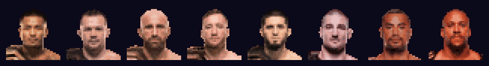

# UFC 8-BIT — painel dos lutadores ranqueados



Painel com estética de fliperama 8-bit para explorar os dados dos lutadores **ranqueados nas 8 divisões masculinas do UFC**. Você escolhe a divisão, depois o lutador numa grade de personagens (como na tela de seleção de um jogo de luta) e vê estatísticas, bio e histórico completo de lutas.

**▶ Acesse online: https://schneiderweisse.github.io/UFC-data/**

---

## Funcionalidades

**1. SELECT DIVISION.** Oito "cartuchos", um por divisão (Flyweight a Heavyweight), cada um com o sprite do campeão, o limite de peso e o nome do campeão.

**2. CHOOSE YOUR FIGHTER.** Grade 4×4 com o campeão (borda dourada) e o top 15 da divisão. O campeão e o desafiante nº 1 aparecem em tamanho grande nas laterais, um de frente para o outro. O cursor pisca no lutador sob o mouse.

**3. Perfil do lutador**
- **Card do personagem:** sprite, apelido, cartel (V-D-E), vitórias e derrotas por (T)KO e por finalização, e link para o perfil na ESPN.
- **ATTRIBUTES:** barras no estilo RPG para precisão de golpes, golpes significativos por luta, knockdowns por luta, precisão e média de quedas e tentativas de finalização por luta. Cada barra mostra o **percentil do lutador entre todos os ranqueados** (10 blocos = melhor do grupo) e vem acompanhada do valor real.
- **WIN / LOSS METHODS:** um bloco por luta (verde = vitória, vermelho = derrota), separado por KO/TKO, finalização e decisão.
- **LAST 5 FIGHTS:** resultado e adversário das 5 lutas mais recentes.
- **SIGNIFICANT STRIKES PER FIGHT:** gráfico de golpes significativos tentados × acertados em cada luta, colorido pelo resultado.
- **FIGHT HISTORY:** todas as lutas profissionais, com data, adversário, método, round, tempo e evento (★ = disputa de cinturão).
- Os botões **◄ ►** passam para o lutador anterior ou o próximo da divisão.

Na versão online, cada tela tem um link próprio (ex.: [`#/f/3949584`](https://schneiderweisse.github.io/UFC-data/#/f/3949584) abre o perfil do Volkanovski), e o botão "voltar" do navegador funciona.

---

## Origem dos dados

| O quê | Fonte | Como |
|---|---|---|
| Lista de ranqueados (campeão + top 15 de cada divisão masculina) | [UFC.com/rankings](https://www.ufc.com/rankings) | HTML da página, lido com BeautifulSoup |
| ID de cada lutador na ESPN | API de busca da ESPN (`site.web.api.espn.com/apis/search/v2`) | busca pelo nome |
| **Bio** e **Fight History** | API pública da ESPN (`site.web.api.espn.com/apis/common/v3/sports/mma/athletes/<id>`) | JSON |
| **Stats** (tabelas Striking, Clinch e Ground) | mesma API, endpoint `/athletes/<id>/stats` | JSON |
| Fotos usadas nos sprites | CDN de imagens da ESPN (`a.espncdn.com/i/headshots/mma/...`) | PNG, depois pixelado |

A API da ESPN é a mesma que alimenta as abas **Stats**, **Fight History** e **Bio** das páginas de lutador do site (por exemplo, [espn.com/mma/fighter/_/id/3949584](https://www.espn.com/mma/fighter/_/id/3949584/alexander-volkanovski)). Por isso, os dados são os mesmos dessas tabelas, só que em formato estruturado.

**Coleta feita em 01/11/2026.** O ranking muda a cada evento, então rode o scraper de novo para atualizar.

### Arquivos em `Fighter data/`

| Arquivo | Conteúdo |
|---|---|
| `ranked_fighters.csv` | divisão, posição no ranking (`C` = campeão), nome, ID e link da ESPN |
| `bio.csv` | apelido, país, categoria, altura, peso, envergadura, idade, base, estilo, equipe, cartel |
| `fight_history.csv` | uma linha por luta: data, adversário, resultado, método, round, tempo, evento, disputa de cinturão |
| `stats_striking.csv` | golpes por luta: à distância por alvo (cabeça, corpo e perna), totais, significativos e knockdowns |
| `stats_clinch.csv` | golpes no clinch, reversões, quedas tentadas e conectadas |
| `stats_ground.csv` | golpes no chão, avanços de posição e tentativas de finalização |
| `stats_glossary.csv` | significado de cada sigla (SDHL/A, TDL, ADTB…) |

Todos os arquivos têm `espn_id`, `ufc_division` e `ufc_rank`, e as tabelas de stats e o histórico têm `event_uid`. É por essas colunas que eles se cruzam.

### Limitações conhecidas
- **Muhammad Saidov** (#13 meio-pesado) está fora porque não existe perfil dele na ESPN.
- A ESPN só tem estatísticas detalhadas das lutas que cobriu, basicamente as do UFC. Lutas antigas ou de outras organizações aparecem no histórico, mas não nas stats nem nos atributos.
- **Homônimos:** existem, por exemplo, três "Jean Silva" de MMA na ESPN. Quando há nomes iguais, o scraper escolhe o perfil com mais lutas no UFC.
- A categoria no ranking do UFC pode diferir da que a ESPN registra (ex.: Alex Pereira). Os dois campos são mantidos.

---

## Como foi feito

O pipeline é todo em Python:

```
UFC.com/rankings ──► scrape_espn_fighters.py ──► Fighter data/*.csv
API da ESPN    ──┘                                  │
                                                    ▼
fotos da ESPN ──► dashboard/build_sprites.py ──► sprites 8-bit
                                                    │
                       dashboard/data.py ◄──────────┘   (agregações com pandas)
                         │                 │
                         ▼                 ▼
                 dashboard/app.py   dashboard/build_static.py
                 (painel Dash,      (gera docs/ para o
                  roda localmente)   GitHub Pages)
```

1. **Extração** (`scrape_espn_fighters.py`, com `requests` e `BeautifulSoup`). O script lê o ranking oficial, encontra o ID de cada lutador na busca da ESPN e baixa bio, histórico e estatísticas pela API JSON. As três tabelas de stats saem em CSVs separados, como no site. As requisições têm uma pausa entre si para não sobrecarregar os servidores.
2. **Sprites** (`dashboard/build_sprites.py`, com `Pillow`). Cada foto é recortada em cabeça e ombros, reduzida para uma grade de **36×36 pixels** com **paleta de 18 cores** sem dithering, contornada com 1 px preto (visual de sprite de fliperama) e ampliada 6× sem suavização. Quem não tem foto recebe uma silhueta genérica.
3. **Agregações** (`dashboard/data.py`, com `pandas`). Junta as três tabelas de stats, descarta as lutas sem estatística (vêm zeradas), classifica o método de cada luta (KO/TKO, finalização, decisão, outros) e calcula os atributos e seus percentis. Só lutadores com 3 ou mais lutas com estatística entram na régua do percentil.
4. **Painel local** (`dashboard/app.py`, com **Dash** e Plotly). São três telas controladas por callbacks. O visual 8-bit vem todo do CSS (`dashboard/assets/style.css`):
   - fontes *Press Start 2P* e *VT323*;
   - bordas "em degrau" feitas com `box-shadow`;
   - scanlines de monitor CRT;
   - `image-rendering: pixelated` para os sprites não borrarem;
   - animações em `steps()` para o efeito de piscar.
5. **Versão online** (`dashboard/build_static.py`). O GitHub Pages só hospeda arquivos estáticos e não executa Python. Por isso, o script roda as mesmas agregações do `data.py` e exporta o resultado em `docs/data.json`. A página (`dashboard/static/index.html` + `app.js`, JavaScript puro e Plotly.js) só desenha esses dados, com o mesmo CSS e o mesmo layout do app Dash.

---

## Como rodar

Requer Python 3.10+.

```bash
pip install -r requirements.txt
```

**Painel local (Dash):**
```bash
python dashboard/app.py
```
Depois, abra http://127.0.0.1:8050.

**Atualizar os dados e o site:**
```bash
python scrape_espn_fighters.py        # baixa ranking + dados da ESPN (~5 min)
python dashboard/build_sprites.py     # gera sprites de lutadores novos (--force refaz todos)
python dashboard/build_static.py      # regenera docs/
git add -A && git commit -m "Atualiza dados" && git push
git subtree push --prefix docs origin gh-pages   # publica docs/ no GitHub Pages
```

## Estrutura do repositório

```
├── scrape_espn_fighters.py   extração (UFC.com + API da ESPN)
├── Fighter data/             CSVs extraídos
├── dashboard/
│   ├── app.py                painel Dash (local)
│   ├── data.py               carga dos CSVs e agregações
│   ├── build_sprites.py      fotos → sprites 8-bit
│   ├── build_static.py       gera a versão estática em docs/
│   ├── static/               index.html + app.js da versão estática
│   └── assets/               style.css e sprites/
├── docs/                     site publicado no GitHub Pages (gerado, não editar à mão)
└── requirements.txt
```

---

## Aviso

Projeto de fã, sem fins comerciais e **sem qualquer afiliação com UFC ou ESPN**. Os dados, os rankings, os nomes e as fotos originais pertencem aos respectivos donos. Os sprites são versões pixeladas das fotos da ESPN e são usados apenas para fins educacionais e de visualização.
